<meta name="description" content="ECOFLOR 2027 – 24th Annual Meeting of the Floral Ecology and Evolution Working Group, 3–6 February 2027, Přírodovědecká fakulta UK, Praha (Prague), Czech Republic." />
<meta name="keywords" content="ECOFLOR 2027, floral ecology, pollination, Praha, Prague, conference, plant-pollinator" />
<meta name="referrer" content="strict-origin-when-cross-origin" />

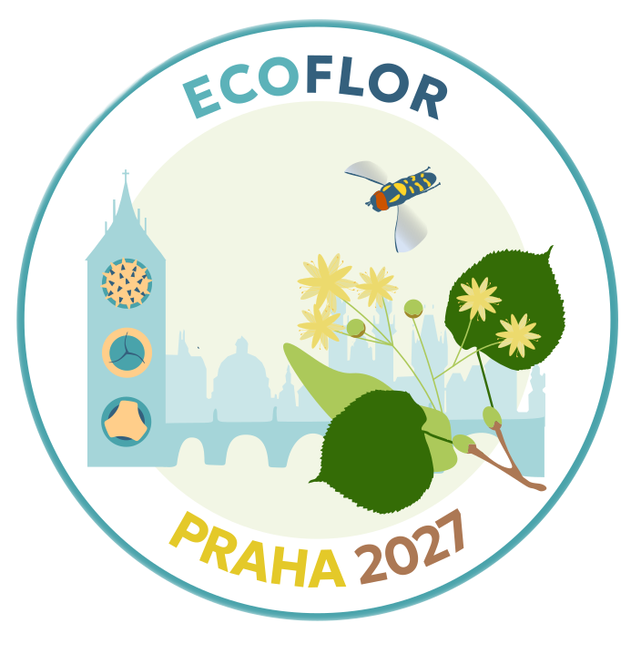{fig-align="center" width="600"}

::: {#about style="text-align: center;"}
## About
:::

::: {style="text-align: justify;"}
::: {#welcome style="text-align: center;"}
**Welcome to the 24th Annual Meeting of the Floral Ecology and Evolution Working Group – ECOFLOR 2027!**
:::

We are delighted to announce the **24th Annual Meeting of ECOFLOR**, which will take place from **3–6 February 2027** in [**Praha (Prague)**](https://en.wikipedia.org/wiki/Prague), Czech Republic, hosted by the [**Faculty of Science, Charles University**](https://www.natur.cuni.cz/eng) (Přírodovědecká fakulta UK).

EcoFlor is a working group of the [**Spanish Association of Terrestrial Ecology (AEET)**](https://www.aeet.org/es/english/). It organises an annual congress to discuss recent scientific findings on floral ecology and evolution. For the first time, the 2027 meeting moves to Central Europe, bringing together researchers from across the world in the heart of one of Europe's most beautiful cities.

The EcoFlor annual meeting brings together scientists interested in floral ecology and evolution. Its goal is to promote discussion, networking, and creativity in science, involving students at all career stages in an open and friendly environment. Participants are invited to present their ongoing projects and engage in critical scientific discussion and networking.

The meeting will feature plenary talks by [**Dr Robert Tropek**](#robert_tropek) and [**Dr Katherine Baldock**](#katherine_baldock) (one on [Wednesday evening](#programme) to open the meeting, and one on [Thursday evening](#programme)), alongside two full days of oral and poster presentations (Thursday 4th and Friday 5th February, **09:00–19:00**), thematically organised based on submitted abstracts.

In addition, there will be two possible excursions on [**Saturday 6th February**](#excursion):

1. to the [Milovice Nature Reserve](#excursion-milovice) to see the reintroduced **European Bison** (*Bison bonasus*) and other large herbivores in the Czech wild steppe. [Details](#excursion-milovice).
2. [Guided tour of **Prague historical centre** and pubs](#excursion-prague).

All contributions should be in **English** to promote discussion and interaction with our international audience.

### Meeting information summary {style="text-align: center;"}

::: {style="text-align: left;"}
📅 **3–6 February 2027**

📍 [Přírodovědecká fakulta UK, Praha](https://www.natur.cuni.cz/eng), Viničná 7, Praha 2 – [Velká zoologická posluchárna](https://natur.cuni.cz/en/contacts/maps/campus-map/building-vinicna-7/vinicna-7-2nd-floor) (2nd floor)

🎤 Plenary speakers: [Dr. Robert Tropek](#robert_tropek) & [Dr. Katherine Baldock](#katherine_baldock) ([Wednesday evening](#programme) & [Thursday evening](#programme))

🦬 [Excursion to Milovice Nature Reserve](#excursion-milovice) on [**Saturday 6th February**](#programme)

🍺 [Excursion – Guided tour of Prague historical centre & pubs](#excursion-prague) on [**Saturday 6th February**](#programme)

🍲 Lunches & catering – lunches are not provided, but coffee/refreshments will be served during breaks and we recommend [several great lunch options nearby](#where-to-eat-and-drink)

🍻 Conference dinner – **Thursday 4 February (20:00)** after the scientific programme (expected cost up to ~30 EUR per person; venue and details to be specified)

✉️ [Registration](#registration) – **open from 20 October 2026!** Deadline **20 November 2026** (notification of acceptance by **15 December 2026**)

📞 [Contact](#contact) via [Discord](https://discord.gg/YCXbyRmUX5), [WhatsApp group chat](https://chat.whatsapp.com/KCycNVzqLEm1orgBQGjrQ2?mode=ems_copy_t) or [email](mailto:ecoflor2027@googlegroups.com)

:::
:::

::: {#logo-story}
### The Story Behind the Logo {style="text-align: center;"}

::: {.logo-story-card}
The ECOFLOR 2027 logo weaves together Central European botany, Prague’s iconic landmarks, and pollination biology:

- 🍃 **Small-leaved Lime (*Tilia cordata* / lípa srdčitá):** The national tree of the Czech Republic, revered since the 19th century as a Slavic symbol of freedom and protection. In floral ecology, linden trees are celebrated for their sweetly fragrant, nectar-rich blossoms and distinct pale bracts, sustaining dense communities of bees, hoverflies, and other pollinators in early summer across Central Europe.
- 🌉 **Charles Bridge (*Karlův most*):** Prague’s historic 14th-century Gothic stone bridge across the Vltava River — representing our host city and symbolising the bridges of collaboration and community that ECOFLOR fosters across European researchers.
- 🕰️ **The Astronomical Clock (*Pražský orloj*):** The iconic 1410 medieval clock tower of Prague’s Old Town Hall, rendered with a playful pollination biology twist: its astronomical and calendar dials are reimagined as **microscopic pollen grains** (echinate and aperture structures), honouring the floral structures central to pollination research.
- 🪰 **The Hoverfly (Syrphidae):** Approaching the lime flowers, honouring the diverse non-bee insect pollinators that play an indispensable role in plant reproduction and floral evolutionary ecology.
:::
:::

---

::: {#registration style="text-align: center;"}
## Registration
:::

::: {.registration-cta}
::: {.cta-title}
✨ Registration is Now Open! ✨
:::

::: {.cta-subtitle}
Attendance at ECOFLOR 2027 is **free**, but registration is **mandatory** for logistical reasons.<br>
Submissions open: **20 October 2026** &nbsp;|&nbsp; Deadline: **20 November 2026** &nbsp;|&nbsp; Notification of acceptance: **15 December 2026**
:::

::: {.cta-button-wrap}
<a href="https://forms.gle/HFG9EKboVBc1kqF76" target="_blank" rel="noopener noreferrer" class="btn-register">
  <i class="bi bi-pencil-square"></i> Register for ECOFLOR 2027 <i class="bi bi-arrow-right-short"></i>
</a>
:::
:::

::: {#registration_info style="text-align: justify;"}
::: {style="text-align: center;"}
#### Registration and Contributions
:::

Attendance at the meeting is **free**, but registration is **mandatory** for logistical reasons. Please fill out the [**registration form**](https://forms.gle/HFG9EKboVBc1kqF76) if you plan to attend. Registration and abstract submission open on **20 October 2026**, and the deadline is **20 November 2026**.

The meeting will take place **in person**. While presentations will be given on site, we would like to record talks and share the recordings with the community after the conference (only where permitted by the speakers).

When registering, you can also submit a proposal for an [**oral**](#oral-presentations) or [**poster**](#poster-presentations) presentation. Awards will be given for the **best oral** and **best poster** presentations.

We also welcome proposals for **Rising Stars talks** — **20-minute presentations (+ Q&A)** aimed at early-career researchers with exciting research to showcase. These are a great opportunity to present a broader research line, a breakthrough idea, or an emerging topic in more depth than a standard oral presentation allows.

We also welcome proposals for [**workshops**](#workshops) to be held on the first day of the meeting ([Wednesday 3 February](#programme)). We especially encourage workshops that help early-career researchers develop skills, such as fieldwork methods, sample processing, laboratory protocols, data analysis, and scientific writing. Discussions on emerging topics and networking opportunities are also welcome!

::: {style="text-align: center;"}
#### Important Note
:::

The meeting has a **limited number of places**. Acceptance will be based on a combination of factors: order of registration, whether you submit a contribution, and scientific scope. We highly encourage young researchers to submit their contributions, as the scientific committee will give them priority. Notification of acceptance will be sent by **15 December 2026**.

::: {style="text-align: center;"}
#### Preparing Your Abstract
:::

Please submit your abstract in **English** during the registration process. The abstract should **not exceed 200 words**. When submitting, choose **one primary keyword** (required) from the list in the registration form to help us organise conference sessions, and optionally **1–2 additional keywords** if your work spans multiple topics.

Each main author may submit only **one contribution**. We kindly request that the main author is the one submitting the abstract.

::: {style="text-align: center;"}
#### Oral Presentations
:::

Oral presentations will be **10 minutes long, followed by 2 minutes of discussion** (12 minutes total); slides should be in English.

::: {style="text-align: center;"}
#### Poster Presentations
:::

Posters should be prepared in standard **A0 format (portrait / vertical orientation)**. Posters will be displayed throughout the conference. Poster sessions will take place during coffee breaks: a 30-minute session in the morning and a one-hour session in the afternoon, specifically designed to encourage discussion and networking.

::: {style="text-align: center; margin: 2.5rem 0 1.5rem 0;"}
<a href="https://forms.gle/HFG9EKboVBc1kqF76" target="_blank" rel="noopener noreferrer" class="btn-register">
  <i class="bi bi-pencil-square"></i> Register for ECOFLOR 2027 <i class="bi bi-arrow-right-short"></i>
</a>
:::

:::

::: {#programme}
## Programme {style="text-align: center;"}

::: {style="text-align: center;"}
🗓 Preliminary outline — the detailed programme will be announced after the registration deadline.
:::

::: {.programme-days}
::: {.programme-day}
#### Wednesday 3 February {.programme-title}
- 10:00 🔬 [**Workshops**](#workshops): ["Pollinators for Non-Entomologists"](#workshops) & ["Introduction to YOLO and Visual Tools"](#workshops)
- 📝 [**Registration**](#registration) 
- 14:00 💼 [**Networking**](#networking): Mentoring and collaboration matching
- 17:00 🎤 [**Opening plenary talk**](#speakers) 
- 🍻 **Meet & greet**
:::

::: {.programme-day}
#### Thursday 4 February {.programme-title}
- 09:00–19:00 🗣 [**Oral presentations**](#oral-presentations)
- 🌼 [**Poster session**](#poster-presentations)
- 🎤 [**Plenary talk** (evening)](#speakers)
- 20:00 🍻 **Conference dinner** (after the programme; venue to be announced)
:::

::: {.programme-day}
#### Friday 5 February {.programme-title}
- 09:00–19:00 🗣 [**Oral presentations**](#oral-presentations)
- 🌼 [**Poster session**](#poster-presentations)
- 🎉 **Closing ceremony**
:::

::: {.programme-day}
#### Saturday 6 February {.programme-title}
- 🦬 [**Excursions**](#excursion) — two options:
  - [**Milovice Nature Reserve**](#excursion-milovice) (European Bison & wild herbivores)
  - [**Prague**](#excursion-prague) (walk through the historical centre with a local guide)
- Details to be announced
:::
:::

:::

---

::: {#workshops}
## Workshops: Wednesday 3 February (10:00)
:::

Two hands-on workshops will be offered on the first day of the conference (starting at 10:00). Both are free for registered participants. Spaces are limited, so early registration is encouraged.

::: {style="text-align: center;"}
#### Workshop 1: Pollinators for Non-Entomologists
:::

::: {style="text-align: left;"}
**Leader:** Tadeáš Ryšan  
**Capacity:** 25 participants

Insect pollinators represent an exceptionally diverse group of organisms, yet many researchers studying plant–pollinator interactions have limited experience with insect identification. This workshop aims to introduce the diversity of insect pollinators and provide participants with practical skills for recognizing and distinguishing their major taxonomic and functional groups.

The workshop is designed primarily for pollination researchers without a background in entomology. Participants will be introduced to the morphological diversity of major pollinator groups, including Hymenoptera, Diptera, Coleoptera, and Lepidoptera, with particular attention to characters useful for their identification. Using a simplified identification key and practical examples, participants will learn how to assign specimens to basic taxonomic or functional groups suitable for ecological analyses. These skills will also help researchers sort collected material into meaningful categories for subsequent, more detailed taxonomic identification.

The overall goal is not to provide species-level identification skills, but rather to help participants better understand pollinator diversity, recognize important morphological differences, and develop a practical foundation for incorporating insect identification into their own research.
:::

::: {style="text-align: center;"}
#### Workshop 2: Basic Introduction to YOLO and Visual Analytical Tools
:::

::: {style="text-align: left;"}
**Leader:** Jakub Štenc  
**Capacity:** 15 participants

Do you need to do repetitive image or video analysis and are tired of doing it manually? Do you need to count objects from images or videos? Recognize movement of pollinators or track your plants' growth? You don't need to do that manually anymore!

This workshop will introduce you to automated visual analysis tools and the YOLO (You Only Look Once) framework. We are not going to teach you everything, but during the workshop we will show you examples of pipelines and selected tools we have experience with. At the end of the workshop, we hope to point you in the direction to solve your particular questions and jumpstart your own image analysis projects.
:::

---

::: {#networking}
## Networking: Wednesday 3 February (14:00)
:::

::: {style="text-align: justify;"}
On Wednesday afternoon (starting at 14:00), we will host an informal networking and mentoring session for those seeking connections within the community. Whether you are looking for a supervisor, students, collaboration opportunities, a postdoc position, or an internship — this is your chance to meet potential collaborators and colleagues. Sign up during registration to indicate what you're looking for, and we'll facilitate connections.
:::

---

::: {#speakers style="text-align: center;"}
## Plenary Speakers

Two plenary talks will take place during the meeting: one on [**Wednesday 3 February** (17:00)](#programme) opening the scientific programme, and the other on [**Thursday 4 February** (evening)](#programme).
:::

:::  {.speaker-card #robert_tropek}
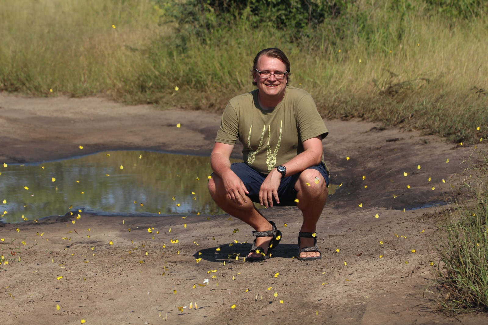{.speaker-photo fig-alt="doc. Robert Tropek"}

::: {style="text-align: center;"}
#### doc. Robert Tropek [{width="22"}](https://scholar.google.com/citations?hl=cs&user=0UDnavUAAAAJ)

#### *Geographic patterns in plant–pollinator interactions: from mountain slopes to the globe*
:::

::: {style="text-align: justify;"}
Robert Tropek is an associate professor and head of the Insect Community Ecology Research Group based at the Faculty of Science, Charles University, and the Institute of Entomology, Biology Centre of the Czech Academy of Sciences. His research focuses on insect diversity, community ecology and conservation in both natural and human-modified habitats, with butterflies and moths as the main focal groups. In plant–pollinator interactions, he is particularly interested in (and perhaps even obsessed with) the trade-offs between specialisation and generalisation. He studies the degree of specialisation in plant–pollinator interactions across scales, from the fine details of particular systems to broad geographic patterns and their drivers. Much of his field research is based in tropical African ecosystems, especially on Mount Cameroon and in southern Africa, complemented by comparative work in European temperate ecosystems.
In his plenary talk, he will explore how plant–pollinator communities and their interactions change across geographic gradients, moving from elevational gradients on Mount Cameroon and in the Krkonoše Mountains to a global synthesis of more than 3,400 pollination networks. He will ask whether plant and pollinator diversity, floral traits and interaction specialisation follow general geographic rules, and why apparently simple gradients often produce complex, context-dependent patterns.


:::
:::

:::  {.speaker-card #katherine_baldock}
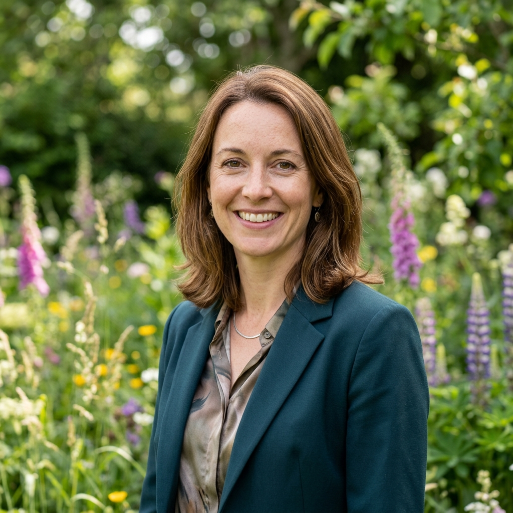{.speaker-photo fig-alt="Dr Katherine Baldock"}

::: {style="text-align: center;"}
#### Dr Katherine Baldock [{width="22"}](https://scholar.google.com/citations?hl=cs&user=ntJPwpkAAAAJ)

#### To be Announced
:::

::: {style="text-align: justify;"}
To be Announced.

:::
:::

---

::: {#excursion style="text-align: center;"}
## Excursions: Saturday 6 February
:::

::: {style="text-align: justify;"}
The conference excursion will take place on [**Saturday 6th February 2027**](#programme). Participants can choose between two exciting options:
:::

::: {style="text-align: center;"}
### Option 1: European Bison at Milovice Nature Reserve {#excursion-milovice}
:::

, via [Wikimedia Commons](https://commons.wikimedia.org/wiki/File:Zubr_v_P%C5%99%C3%ADrodn%C3%AD_rezervaci_velk%C3%BDch_kopytn%C3%ADk%C5%AF_Milovice,_lokalita_Traviny_u_Ben%C3%A1tek_nad_Jizerou.jpg)](images/bison_milovice.jpg){fig-align="center" width="700" fig-alt="European bison grazing in the steppe grassland of the Milovice Nature Reserve"}

::: {style="text-align: justify;"}
The conference excursion will take place on **Saturday 6th February 2027**. We will visit the [**Milovice Nature Reserve**](https://en.wikipedia.org/wiki/Milovice_Nature_Reserve), located approximately 40 km east of Prague, where you can encounter **European Bison** (*Bison bonasus*), **Exmoor Ponies**, and **wild oxen** (back-bred aurochs / Tauros cattle) roaming freely in a rewilded Czech steppe landscape.

The Milovice reserve is one of Central Europe's most exciting rewilding projects — a former military training area that has been transformed into a haven for large herbivores and grassland biodiversity. The project is run by the [**European Wildlife Foundation**](https://www.european-wildlife.eu/) and serves as a flagship example of large-scale rewilding in Central Europe.

From the perspective of floral ecology, the reserve is a remarkable case study: the grazing and browsing by large herbivores shapes plant communities, floral diversity, and pollinator habitats across the steppe grasslands.

Capacity is limited to 60 participants. Public transport (train) will most likely be used from [Praha Hlavní Nádraží](https://maps.app.goo.gl/HgYZuyYPNbUpmqKx5) and back and it is not organized by the conference organisation committee, but information will be provided to registered participants. Additional costs are expected to be ~10 EUR per person for the train tickets.  

::: {style="text-align: center;"}
🦬 Further details (transport, timing, costs) will be provided to registered participants.
:::

:::


```{=html}
<div style="display: flex; justify-content: center; margin: 1.5rem auto;">
  <iframe src="https://www.google.com/maps/embed?pb=!1m18!1m12!1m3!1d16322.565429630642!2d14.87585409293312!3d50.24400106417309!2m3!1f0!2f0!3f0!3m2!1i1024!2i768!4f13.1!3m3!1m2!1s0x470bf80b979973e1%3A0x84aefd91301eea18!2sRezervace%20divok%C3%BDch%20kon%C3%AD!5e1!3m2!1sen!2sus!4v1791982410689!5m2!1sen!2sus" width="100%" height="450" style="max-width: 700px; border:0; border-radius: 12px; box-shadow: 0 4px 16px rgba(0,0,0,0.1);" allowfullscreen="" loading="lazy" referrerpolicy="strict-origin-when-cross-origin"></iframe>
</div>
```

::: {style="text-align: center;"}
### Option 2: Historical Prague Walking Tour {#excursion-prague}
:::

](https://upload.wikimedia.org/wikipedia/commons/thumb/9/91/Nuremberg_Chronicle_f_229v_230r.jpg/1280px-Nuremberg_Chronicle_f_229v_230r.jpg){fig-align="center" width="700" fig-alt="Historical woodcut view of Prague from the 1493 Nuremberg Chronicle"}

::: {style="text-align: justify;"}
For participants wishing to stay in Prague, we will organise a **walk through the historical centre of Prague with a local guide**. Explore the architectural highlights, historic university grounds, and hidden picturesque streets of the Old and New Towns.

::: {style="text-align: center;"}
🏰 Further details (meeting point, route, timing) will be announced to registered participants.
:::
:::

---

::: {#venue style="text-align: center;"}
## Venue
:::

::: {style="text-align: justify;"}
::: {style="text-align: center;"}
**Welcome to PRAGUE / PRAHA!**
:::

The 24th edition of EcoFlor takes place at the **[Přírodovědecká fakulta UK](https://www.natur.cuni.cz/eng)** (Faculty of Science, Charles University), located at **Viničná 7, Praha 2** — in the heart of Prague, just minutes from the historic city centre.

Oral presentations (including plenary talks) will be held in the **[Velká zoologická posluchárna](https://natur.cuni.cz/en/contacts/maps/campus-map/building-vinicna-7/vinicna-7-2nd-floor)** (Great Zoological Lecture Hall, 2nd floor; [view floor map](https://natur.cuni.cz/kontakty/mapy/mapa-budov/budova-vinicna-7/budova-vinicna-7-2-patro)). Poster sessions will also take place within the faculty building.

```{=html}
<div style="display: flex; justify-content: center; margin: 1.5rem auto;">
  <iframe src="https://www.google.com/maps/embed?pb=!1m18!1m12!1m3!1d2561.2!2d14.4265!3d50.0737!2m3!1f0!2f0!3f0!3m2!1i1024!2i768!4f13.1!3m3!1m2!1s0x470b94e6d86c3a3d%3A0x1f8d8d5a1b6c7e90!2sPr%C3%ADrodov%C4%9Bdeck%C3%A1%20fakulta%20UK!5e0!3m2!1sen!2scz!4v1695000000000" width="100%" height="420" style="max-width: 700px; border:0; border-radius:12px; box-shadow: 0 4px 16px rgba(0,0,0,0.1);" allowfullscreen loading="lazy" referrerpolicy="strict-origin-when-cross-origin"></iframe>
</div>
```

::: {style="text-align: center;"}
### Venue Accessibility
:::

The Faculty of Science building has **elevator access** to all presentation venues. We understand that as a historic building in an equally historic city, the venue may present challenges for participants with mobility or accessibility needs. **Please indicate any barrier-free access requirements in the submission/registration form** so we can best support you.

Prague's public transport system is generally well-adapted to serve people with accessibility needs. If you have specific questions about accessibility at the venue or in the city, please **don't hesitate to reach out** — we're happy to provide additional information and assistance.

::: {style="text-align: center;"}
### Transportation
:::

**By plane:** Prague's [Václav Havel Airport](https://www.prg.aero/en) is well connected to major European cities. From the airport, take **Trolleybus Line 59** to the metro terminus *Nádraží Veleslavín* (line A, green, about 17 minutes), then take the metro to *Náměstí Míru* (about 20 minutes). From there it is a short walk to Viničná 7 or tram ride. Other options include buses 191 or 100, depending on your desired destination in Praha. For connection options from the airport consult **[PID Lítačka](https://app.pidlitacka.cz/)** or [Google Maps](https://maps.app.goo.gl/HgYZuyYPNbUpmqKx5).
The buses are running all day and night, thus you don't have to worry about the time of your arrival (if you will arrive in the middle of the night, you will have to change buses once or twice and it will take a bit longer).

You can buy single tickets from yellow vending machines at every bus stop, or via the [PID Lítačka](https://app.pidlitacka.cz/) app (recommended). The yellow machines accept contactless cards, but **not cash** — make sure to use a card. 

How to find the bus and buy ticket in 4 minutes:

```{=html}
<div class="video-wrapper" style="max-width: 580px; margin: 1rem auto 0.5rem auto;">
  <iframe src="https://www.youtube.com/embed/57WeRN0Nrb4" title="Fast & Cheap: From Prague Airport to the City Centre" frameborder="0" allow="accelerometer; autoplay; clipboard-write; encrypted-media; gyroscope; picture-in-picture; web-share" referrerpolicy="strict-origin-when-cross-origin" allowfullscreen></iframe>
</div>
<p style="text-align: center; font-size: 0.9rem; margin-bottom: 1.5rem;"><a href="https://www.youtube.com/watch?v=57WeRN0Nrb4" target="_blank" rel="noopener noreferrer"><i class="bi bi-box-arrow-up-right"></i> Watch on YouTube: Fast & Cheap – From Prague Airport to City Centre</a></p>
```

> ⚠️ **Avoid the Airport Express bus** — it is significantly overpriced for what it offers and offers no real advantage over the standard public transport connection, which is fast, frequent, and cheap. **Taxis and ride-hailing services from the airport are also notoriously expensive** — Prague's public transport will get you to the venue faster and for a fraction of the cost.

**By train:** Prague's main station (*Praha Hlavní nádraží*) has excellent connections from across Central Europe (Vienna, Budapest, Berlin, Warsaw). From the station, take metro line C (red) direction *Háje*, alight at *I. P. Pavlova* — the faculty is a 5-minute walk.

**By metro:** The closest metro stops are:

- 🟢 **Náměstí Míru** (Line A, green) – 7 min walk
- 🔴 **I. P. Pavlova** (Line C, red) – 7 min walk

**Tickets — use the Lítačka app:** Prague's public transport (operated by [PID](https://pid.cz/en/)) is excellent, affordable, and runs 24 hours. The easiest way to buy tickets is the **[PID Lítačka](https://app.pidlitacka.cz/)** mobile app (available for [Android](https://play.google.com/store/apps/details?id=cz.dpp.praguepublictransport) and [iOS](https://apps.apple.com/cz/app/pid-l%C3%ADta%C4%8Dka/id1140104120)). You can buy single-ride tickets, time passes, and airport zone supplements directly in the app and activate them instantly — no need to find a ticket machine. A **24-hour ticket** costs ~120 CZK (~5 EUR) and is valid on all metro, tram, and bus lines. Tickets can also be purchased from machines at metro stations or by SMS.

A 30-minute single-ride ticket costs 40 CZK (~1.6 EUR) and is valid for one non-transfer journey on buses, trams, or metro (transfers between metro lines are allowed, but you cannot switch to bus/tram after exiting the metro). If you plan to use public transport more, consider a **24-hour ticket** (120 CZK / ~4.8 EUR) or a **3-day pass** (330 CZK / ~13 EUR) — both are excellent value and cover all modes of transport including travel to/from the airport.


🎥 **Not sure how it works?** Watch this short video: [How To Buy A Ticket For Public Transport in Prague](https://www.youtube.com/watch?v=OMbCsMObyfQ)

```{=html}
<div class="video-wrapper" style="max-width: 580px; margin: 1rem auto 0.5rem auto;">
  <iframe src="https://www.youtube.com/embed/OMbCsMObyfQ" title="How To Buy A Ticket For Public Transport in Prague" frameborder="0" allow="accelerometer; autoplay; clipboard-write; encrypted-media; gyroscope; picture-in-picture; web-share" referrerpolicy="strict-origin-when-cross-origin" allowfullscreen></iframe>
</div>
<p style="text-align: center; font-size: 0.9rem; margin-bottom: 1.5rem;"><a href="https://www.youtube.com/watch?v=OMbCsMObyfQ" target="_blank" rel="noopener noreferrer"><i class="bi bi-box-arrow-up-right"></i> Watch on YouTube: How To Buy A Ticket For Public Transport in Prague</a></p>
```

::: {style="text-align: center;"}
### Where to stay
:::

Prague has a wide range of accommodation options at various price points. We recommend booking **well in advance** as February can be busy with winter tourism.

Some options near the venue:

- 🏨 [Hotel Ariston](https://www.ariston.cz/) – close to Náměstí Míru, comfortable 3-star
- 🏨 [Hotel Luník](https://www.lunik.cz/) – quiet location near I. P. Pavlova metro
- 🏠 Airbnb/apartments in **Vinohrady** or **Žižkov** neighbourhoods – charming, walkable, good local restaurants

For budget-conscious participants, hostels in the **Žižkov** and **Vinohrady** neighbourhoods offer great value and are close to the venue. More options can be found on [booking.com](https://www.booking.com) or [hotels.com](https://www.hotels.com).

::: {style="text-align: center;"}
### What to do in Prague
:::

Prague is a spectacular city with a wealth of history, culture, and gastronomy. The faculty is located in the vibrant **Vinohrady** district, known for its Art Nouveau architecture, parks, and excellent local restaurants and wine bars.

Nearby highlights include **Náměstí Míru** square, **Riegrovy sady** park (great city views), the **National Museum**, and the famous **Wenceslas Square**. The **Old Town**, **Charles Bridge**, and **Prague Castle** are 20–30 minutes away by metro or tram.

::: {style="text-align: center;"}
### Honest Guide to Prague 🎥
:::

::: {style="text-align: justify;"}
We recommend the **Honest Guide** YouTube channel, run by local journalists Janek Rubeš and Honza Mikulka. Their videos give practical, honest advice for navigating Prague like a local — avoiding tourist traps, finding the best food and beer, and getting around safely and cheaply.
:::

::: {.columns .video-wrapper-columns}
::: {.column .video-col width="50%"}
```{=html}
<div class="video-wrapper">
  <iframe src="https://www.youtube.com/embed/WJou7DxdP4o" title="Honest Prague Guide – The Only Video You Need" allowfullscreen></iframe>
</div>
```
::: {.video-label}
🗺️ **The Essential Prague Guide** – everything you need to know
:::
:::

::: {.column .video-col width="50%"}
```{=html}
<div class="video-wrapper">
  <iframe src="https://www.youtube.com/embed/Sz_kXQ-Z0Ew" title="Best of Prague in 4 Hours" allowfullscreen></iframe>
</div>
```
::: {.video-label}
🏰 **Best of Prague in 4 Hours** – top sights walking route
:::
:::
:::

::: {.columns .video-wrapper-columns}
::: {.column .video-col width="50%"}
```{=html}
<div class="video-wrapper">
  <iframe src="https://www.youtube.com/embed/OMbCsMObyfQ" title="Prague Public Transport Guide" allowfullscreen></iframe>
</div>
```
::: {.video-label}
🚇 **Public Transport in Prague** – how to buy tickets & get around
:::
:::

::: {.column .video-col width="50%"}
```{=html}
<div class="video-wrapper">
  <iframe src="https://www.youtube.com/embed/DMZLvgAGx3A" title="Worst Scam in Prague – Honest Guide" allowfullscreen></iframe>
</div>
```
::: {.video-label}
⚠️ **Prague Scams to Avoid** – currency exchange & tourist traps
:::
:::
:::

::: {style="text-align: center;"}
### Where to eat and drink
:::

Please note that **lunches are not provided** by the conference. However, there will be a lunch break scheduled each day and Prague has an outstanding food and beer scene with plenty of affordable spots right around the corner. Within walking distance of the faculty (Albertov, Karlovo náměstí, I. P. Pavlova, and Vinohrady), we recommend:

#### Quick Lunch Specials (*Denní Menu*) & Local Bistros (5–8 min walk)
- 🍺 **[Pivovarský dům Benedict](https://online.pivo-dum.cz/)** (Lípová 15) – historic local microbrewery just 5 minutes from the faculty; traditional Czech weekday lunch specials (*svíčková*, goulash, schnitzels) and house-brewed beers.
- 🍽 **[Restaurace U Šumavy](https://www.usumavy.cz/)** (Štěpánská 3) – dependable traditional Czech pub with an honest, budget-friendly daily lunch menu (*denní menu*) and fast service.
- 🍺 **[Kozlovna Tylák](https://www.kozlovnatylak.cz/)** (Tylovo náměstí) – modern Czech pub serving quality weekday lunch specials and fresh tank Kozel beer.
- 🥗 **[Bistro Fair Food Club](https://fairfoodclub.cz/)** (U Nemocnice 4) – ethical social-enterprise bistro with fresh daily lunch menus, soups, vegetarian/vegan bowls, and Georgian *khachapuri*.

#### Dinner, Breweries & International Options
- 🍺 **[Potrefená Husa Albertov](https://www.potrefena-husa-albertov.cz/)** – right below the faculty building; modern Czech cuisine and tank beer, ideal for conference lunches or dinner.
- 🍺 **[Vinohradský pivovar](https://www.vinohradskypivovar.cz/)** – popular neighbourhood microbrewery with excellent craft beer and modern Czech gastropub food.
- 🍽 **[Lokál Korunní](https://lokal-korunni.ambi.cz/)** – legendary Czech pub culture, perfectly tapped Pilsner Urquell, and classic Czech comfort food.
- 🥗 **[Dhaba Beas](https://dhababeas.cz/)** (I. P. Pavlova) – fast, healthy vegetarian/vegan Indian buffet by weight, popular with students and university staff.
- 🥙 **[Paprika Mediterranean Kitchen](https://www.my-paprika.com/)** (I. P. Pavlova) – superb homemade hummus, falafel, and shakshuka.

:::

---

::: {#organisation style="text-align: center;"}
## Organisation Committee
:::


::: {style="text-align: justify;"}
The 24th edition of EcoFlor is organised by researchers based at the **[Faculty of Science, Charles University](https://www.natur.cuni.cz/eng)** (Praha, Czech Republic) in cooperation with the **[Česká společnost pro ekologii](https://www.cspe.cz/)** (ČSPE) and the **[Asociación Española de Ecología Terrestre](https://www.aeet.org/)** (AEET).
:::

\

::: {.columns}
::: {.column .org-col width="33%"}
::: {.org-logo}
[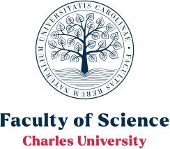{fig-alt="Faculty of Science, Charles University"}](https://www.natur.cuni.cz/eng)
:::

**[Faculty of Science, Charles University](https://www.natur.cuni.cz/eng)** — one of the leading research faculties in the Czech Republic, with a long tradition in botany, ecology, and zoology, and the host of EcoFlor 2027.
:::

::: {.column .org-col width="33%"}
::: {.org-logo}
[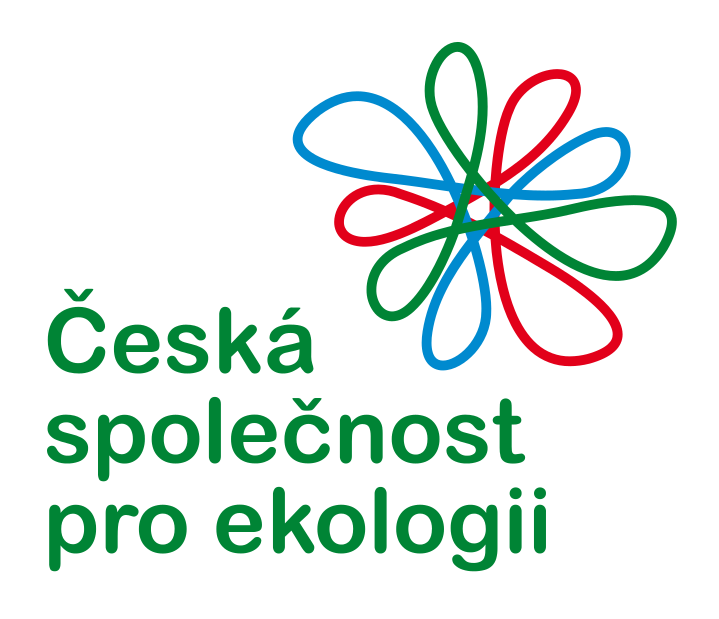{fig-alt="Česká společnost pro ekologii (ČSPE)"}](https://www.cspe.cz/)
:::

**[ČSPE](https://www.cspe.cz/)** — Česká společnost pro ekologii is an independent civic association uniting scientists, academics, students, and other professionals working in ecology in the Czech Republic.
:::

::: {.column .org-col width="33%"}
::: {.org-logo}
[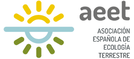{fig-alt="Asociación Española de Ecología Terrestre (AEET)"}](https://www.aeet.org/)
:::

**[AEET](https://www.aeet.org/)** — The Asociación Española de Ecología Terrestre is the Spanish scientific society for terrestrial ecology, promoting ecological research, education, and international collaboration across the Iberian Peninsula and beyond.
:::
:::

\

::: {.columns .committee-person}
::: {.column width="40%"}
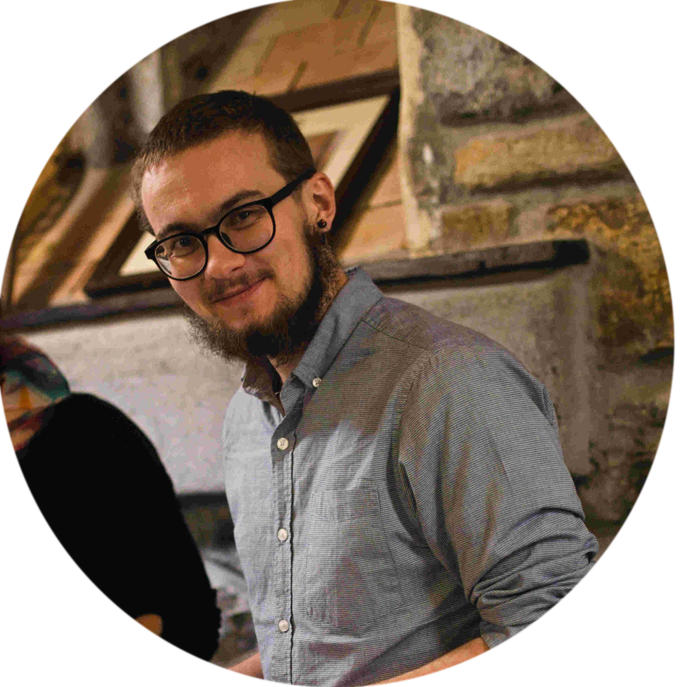{.rounded fig-align="left" fig-alt="Jakub Štenc"}
:::

::: {.column width="60%"}
##### Jakub Štenc

::: {style="text-align: justify;"}
Postdoctoral researcher at the [Faculty of Science, Charles University](https://www.natur.cuni.cz/eng) (Departments of Botany and Zoology, Praha, Czech Republic). He is an ecologist with expertise in plant–pollinator interactions, with particular interest in the dynamics of pollen presentation, transfer and deposition, consequences of pollinator behaviour (preferences and constancy) for pollination networks, and automatisation of image analysis.
:::

::: {style="text-align: center;"}
[✉️](mailto:jakubstenc@gmail.com) [{width="25"}](https://scholar.google.com/citations?user=QrFO4O0AAAAJ&hl=cs) [CV](https://jakubstenc.github.io/jakubstenc/CV.html)
:::
:::
:::

\

::: {.columns .committee-person}
::: {.column width="40%"}
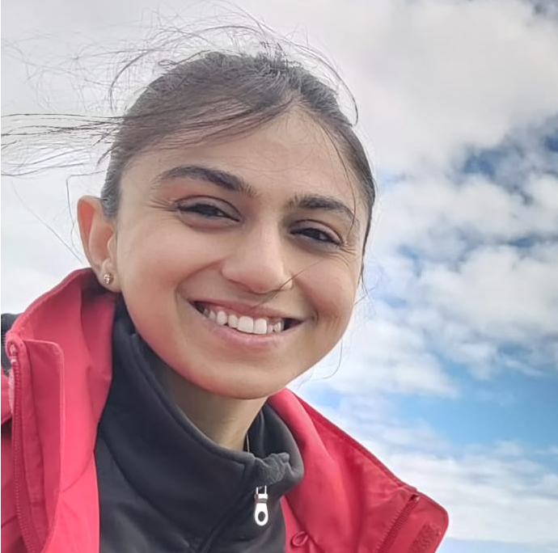{.rounded fig-align="left" fig-alt="Sailee Sakhalkar"}
:::

::: {.column width="60%"}
##### Sailee Sakhalkar

::: {style="text-align: justify;"}
Postdoctoral researcher at the [Institute of Microbiology of the Czech Academy of Sciences](https://mbu.cas.cz/employee/sailee-pradeep-sakhalkar). She is an ecologist with expertise in plant–pollinator interactions. She now works on large-scale patterns in soil microbes, yet remains connected to species interactions and network ecology.
:::
:::
:::

\

::: {.columns .committee-person}
::: {.column width="40%"}
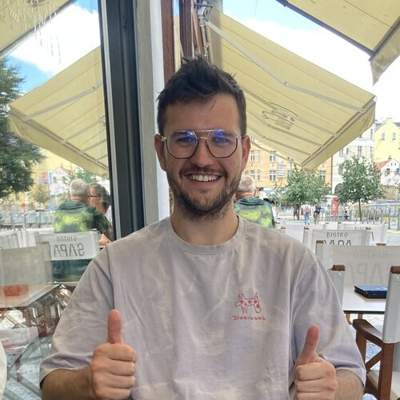{.rounded fig-align="left" fig-alt="Petr Švanda"}
:::

::: {.column width="60%"}
##### Petr Švanda

::: {style="text-align: justify;"}
Doctoral student at the [Faculty of Science, Charles University](https://www.natur.cuni.cz/eng) (Department of Zoology, Prague, Czech Republic). He is interested in pollen in all its aspects, whether it is pollen transfer and deposition, or how it is foraged by facultatively social *Ceratina* bees.
:::
:::
:::

\


::: {.columns .committee-person}
::: {.column width="40%"}
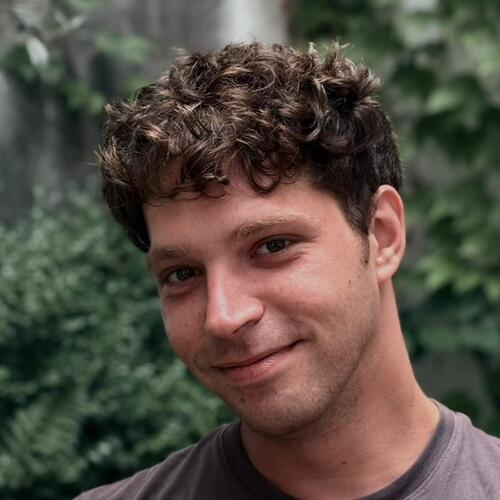{.rounded fig-align="left" fig-alt="Filip Bužleta"}
:::

::: {.column width="60%"}
##### Filip Bužleta

::: {style="text-align: justify;"}
PhD student at the [University of South Bohemia in České Budějovice](https://www.jcu.cz/en) (Czech Republic). He is an ecologist with research interest in monitoring of plant-pollinator interactions using AI cameras and the impact of restoration on plant-pollinator interactions.
:::
:::
:::

\

::: {.columns .committee-person}
::: {.column width="40%"}
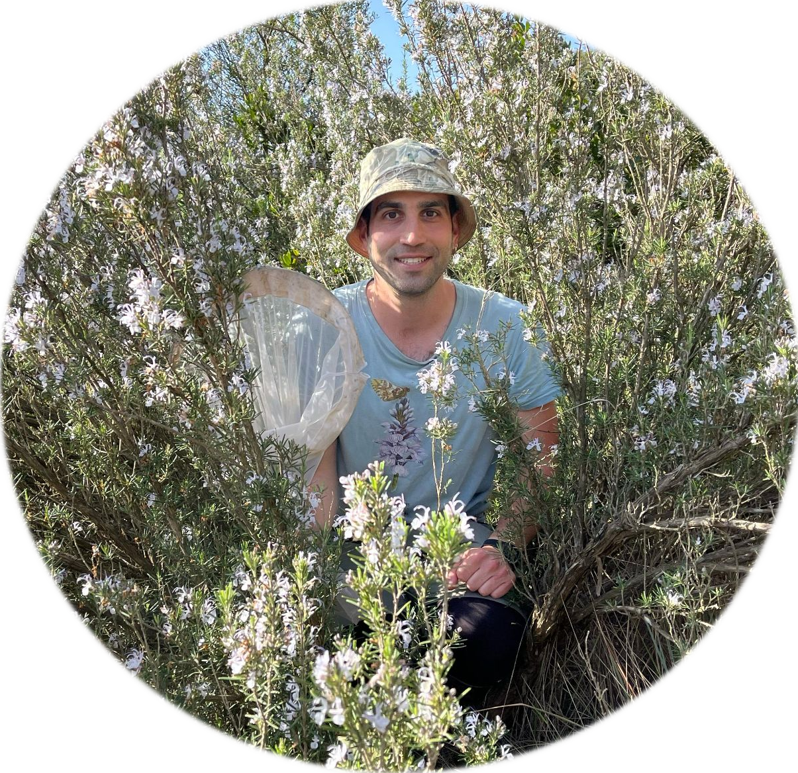{.rounded fig-align="left" fig-alt="Carlos Hernández Castellano"}
:::

::: {.column width="60%"}
##### Carlos Hernández Castellano

::: {style="text-align: justify;"}
Postdoctoral researcher at the [Czech University of Life Sciences](https://www.czu.cz/en) (Prague, Czech Republic). He is an ecologist with expertise in plant-pollinator interactions and with interest in multiple topics of bee ecology, ranging from urban ecology to the influence of large-scale disturbances (herbivory by wildlife, wildfires, and floodings) in the conservation of plant-pollinator systems.
:::
:::
:::

\

::: {.columns .committee-person}
::: {.column width="40%"}
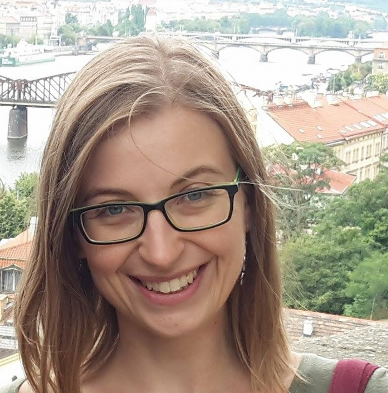{.rounded fig-align="left" fig-alt="Eva Horčičková"}
:::

::: {.column width="60%"}
##### Eva Horčičková

::: {style="text-align: justify;"}
Assistant professor at the [Faculty of Environment, Jan Evangelista Purkyně University in Ústí nad Labem](https://www.ujep.cz/en/uee) (Ústí nad Labem, Czech Republic). She is interested in restoration ecology, pollination ecology, particularly in the role of large herbivores.
:::
:::
:::


\

::: {.columns .committee-person}
::: {.column width="40%"}
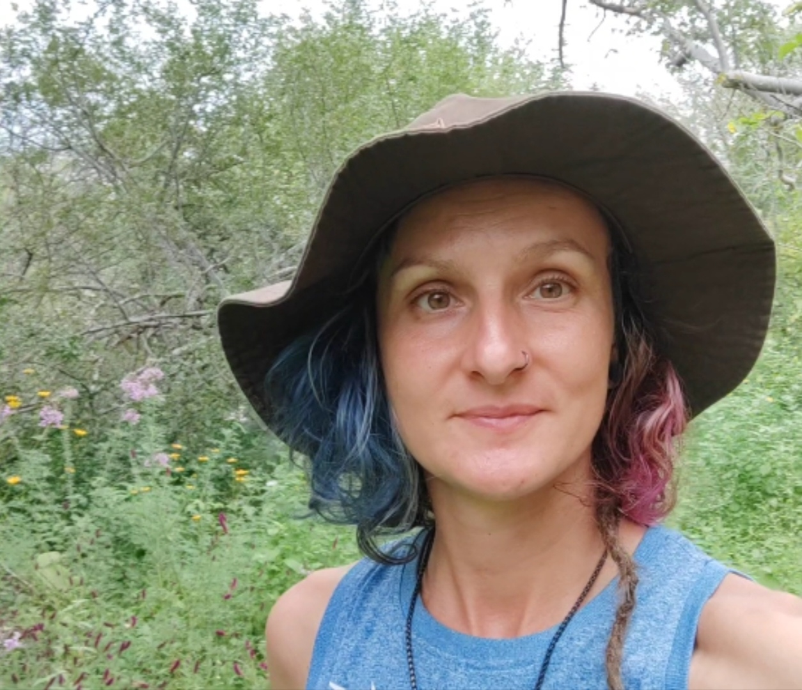{.rounded fig-align="left" fig-alt="Tereza Kočárková"}
:::

::: {.column width="60%"}
##### Tereza Kočárková

::: {style="text-align: justify;"}
PhD candidate at the [Department of Ecology, Faculty of Science, Charles University](https://www.natur.cuni.cz/eng), and the [Institute of Entomology, Biology Centre of the Czech Academy of Sciences](https://www.entu.cas.cz/en/) (Czech Republic). She is an ecologist studying plant – pollinator interactions, with a particular interest in geographical patterns of specialisation within bee communities. Her research combines pollen DNA metabarcoding, quantitative pollen analysis, data on floral traits and rewards, and field observations to investigate how plant – pollinator interaction networks vary across a latitudinal gradient spanning Europe and Africa.
:::
:::
:::
\


::: {.columns .committee-person}
::: {.column width="40%"}
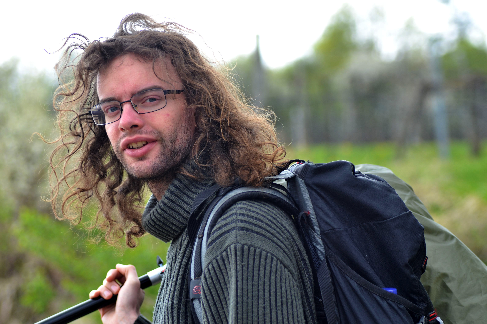{.rounded fig-align="left" fig-alt="Jiří Hadrava"}
:::

::: {.column width="60%"}
##### Jiří Hadrava

::: {style="text-align: justify;"}
Researcher at the [Department of Zoology, Faculty of Science, Charles University](https://www.natur.cuni.cz/eng) (Czech Republic). He is an entomologist focusing on Diptera, especially hoverflies (Syrphidae). His primary focus is on hoverfly ecology, taxonomy and distribution and their role as pollinators. 
:::
:::
:::
\

::: {.columns .committee-person}
::: {.column width="40%"}
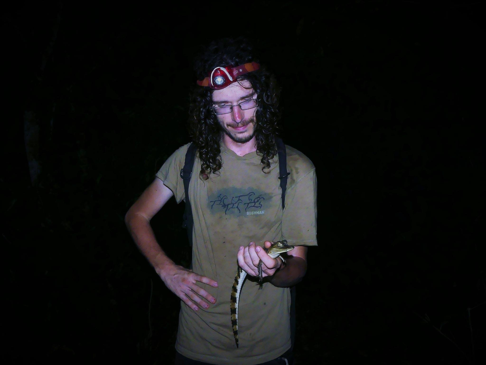{.rounded fig-align="left" fig-alt="Michael Mikát"}
:::

::: {.column width="60%"}
##### Michael Mikát

::: {style="text-align: justify;"}
Researcher at the [Department of Zoology, Faculty of Science, Charles University](https://www.natur.cuni.cz/eng) (Czech Republic). He is an ecologist focusing on evolution and ecology of sociality in bees, and particularly on the trade-offs between reproduction and division of labour. He is also interested in pollination biology. 
:::
:::
:::
\


::: {.columns .committee-person}
::: {.column width="40%"}
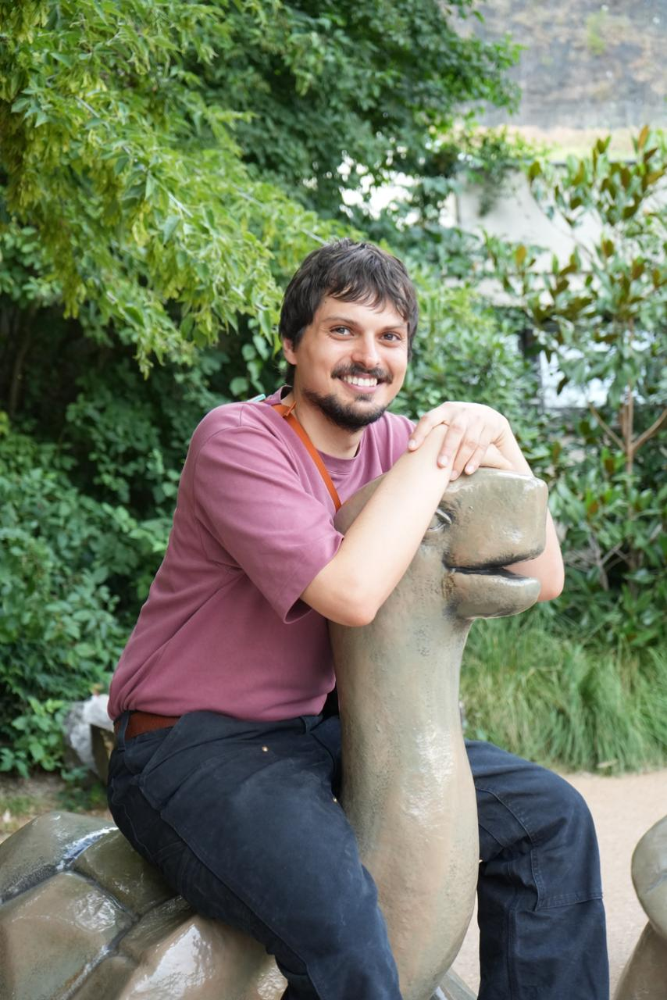{.rounded fig-align="left" fig-alt="Alptekin Koc"}
:::

::: {.column width="60%"}
##### Alptekin Koc

::: {style="text-align: justify;"}
Doctoral researcher at the [Department of Botany of the Faculty of Science of Charles University](https://www.natur.cuni.cz/eng) (Czech Republic). His research focuses on the evolution and ecology of plant breeding systems in pollen limited environments. Currently, he is investigating how plant reproductive strategies differ between tropical and temperate alpine grasslands. Further interests include the investigation of evolutionary drivers behind plant species radiations in the South American Páramos as well as the genetic mechanisms of plant breeding system expression.
:::
:::
:::
\


::: {.columns .committee-person}
::: {.column width="40%"}
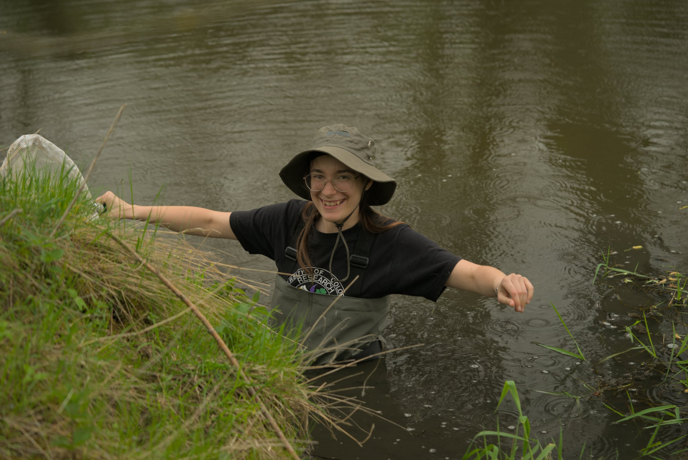{.rounded fig-align="left" fig-alt="Helena Pijálková"}
:::

::: {.column width="60%"}
##### Helena Pijálková

::: {style="text-align: justify;"}
PhD student of [Zoology at Faculty of Science, Charles University](https://www.natur.cuni.cz/eng) (Czech Republic). Focuses on the seasonal differences in composition of alpine pollinators and composition of pollinators and aquatic invertebrates of beaver territories. 
:::
:::
:::
\

::: {.columns .committee-person}
::: {.column width="40%"}
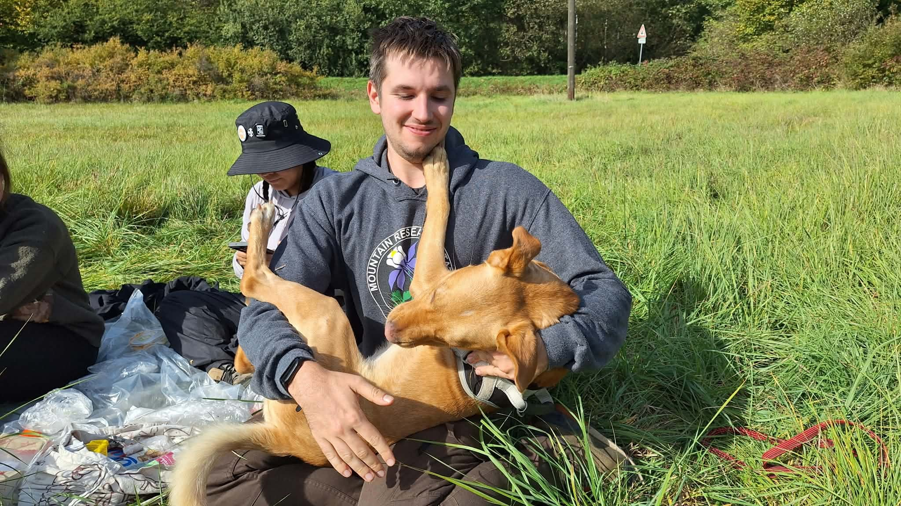{.rounded fig-align="left" fig-alt="Tadeáš Ryšan"}
:::

::: {.column width="60%"}
##### Tadeáš Ryšan

::: {style="text-align: justify;"}
PhD student of [Zoology at Faculty of Science, Charles University](https://www.natur.cuni.cz/eng) (Czech Republic). Focusing on plant-pollinator interactions in various environments. Taxonomic interest in Diptera. 
:::
:::
:::
\

::: {.columns .committee-person}
::: {.column width="40%"}
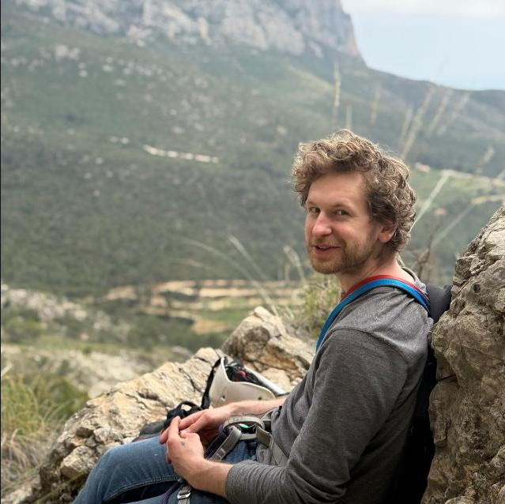{.rounded fig-align="left" fig-alt="Dominik Anýž"}
:::

::: {.column width="60%"}
##### Dominik Anýž

::: {style="text-align: justify;"}
Doctoral student at the [Faculty of Science, Charles University](https://www.natur.cuni.cz/eng) (Department of Ecology, Prague, Czechia). His primary research  interest lies in pollination ecology, focusing on everything from plant breeding systems to analyzing plant-pollinator interaction networks. However, he is fascinated with any interaction dynamics, currently also being employed at the Biology Centre CAS in České Budějovice, where he investigates the role of plant chemistry in mediating interactions between plants, herbivores, and their predators.
:::
:::
:::
\

::: {.columns .committee-person}
::: {.column width="40%"}
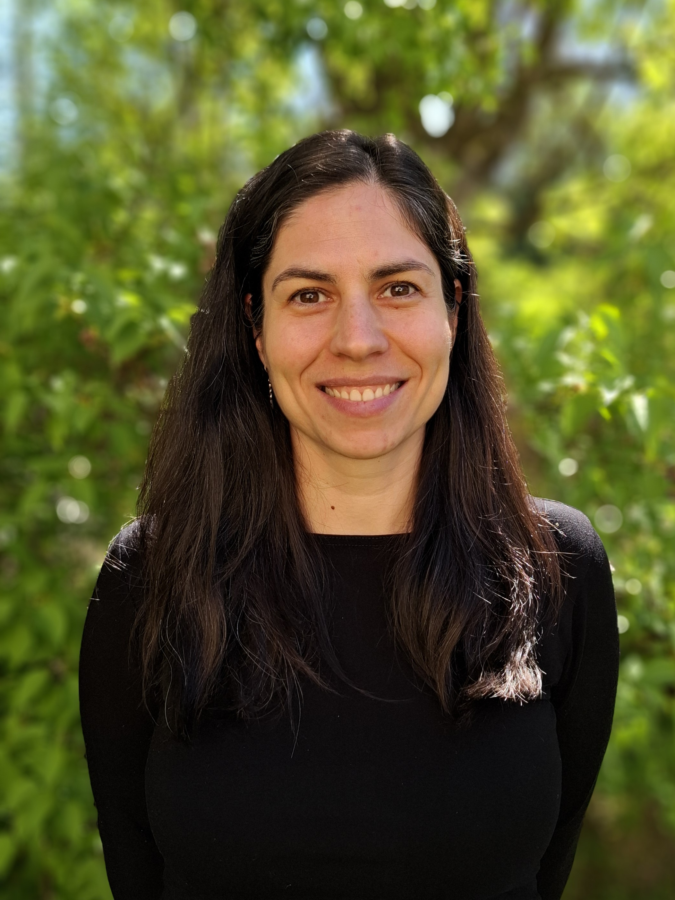{.rounded fig-align="left" fig-alt="Anna E-Vojtkó"}
:::

::: {.column width="60%"}
##### Anna E-Vojtkó

::: {style="text-align: justify;"}
Postdoctoral fellow at [Philipps Universität Marburg](https://www.uni-marburg.de/en), Germany (Evolutionary Ecology of Plants, Department of Biology). She is a plant ecologist with expertise in functional traits and trait-based community assembly. Her research focuses on the dimensionality of plant ecological strategies and the flower economic spectrum.
:::
:::
:::
\

::: {.columns .committee-person}
::: {.column width="40%"}
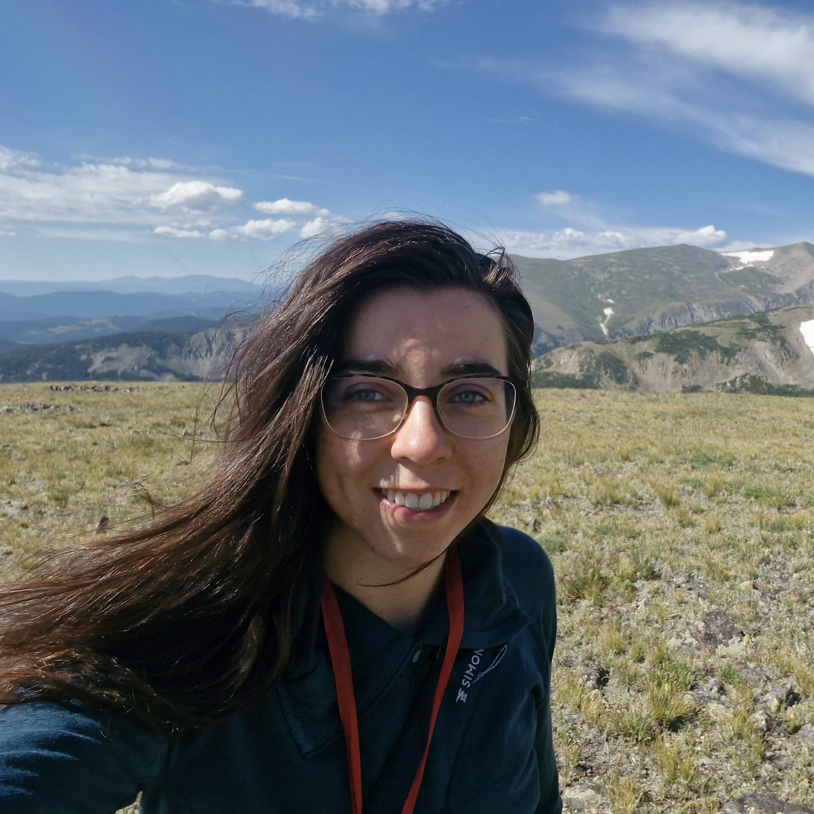{.rounded fig-align="left" fig-alt="Lucie Holzbachová"}
:::

::: {.column width="60%"}
##### Lucie Holzbachová

::: {style="text-align: justify;"}
PhD candidate at the Department of Botany, [Faculty of Science, Charles University](https://www.natur.cuni.cz/eng) (Czech Republic), specializing in high-elevation plant ecology. She is interested in the flower economic spectrum of zoogamous alpine plants and how plant–pollinator interactions and extreme environments drive floral diversity.
:::
:::
:::

::: {.columns .committee-person}
::: {.column width="40%"}
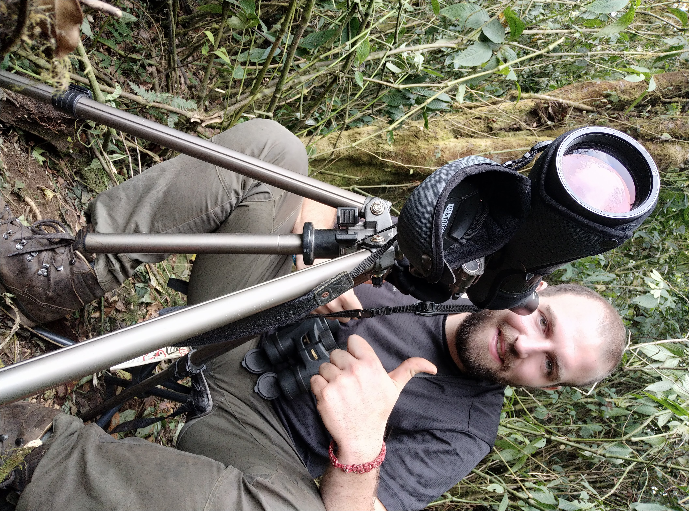{.rounded fig-align="left" fig-alt="Guillermo Uceda"}
:::

::: {.column width="60%"}
##### Guillermo Uceda-Gómez

::: {style="text-align: justify;"}
Guillermo Uceda-Gómez is an ecologist passionate about understanding how species interact and how ecological communities respond to environmental change. He obtained his PhD in Ecology from **[Charles University in Prague](https://www.natur.cuni.cz/eng)** (Czech Republic), focusing on plant–bird pollination networks across elevational gradients and seasons on Mount Cameroon, Central Africa. His research brings together field ecology, ecological modelling, network analysis, and molecular approaches,  to explore the complex relationships between species and their environments. Having participated in several research expeditions to Mount Cameroon, Guillermo has developed a strong appreciation for field-based research and international scientific collaboration. He is particularly interested in advancing our understanding of biodiversity through collaborative research and innovative analytical approaches, with the broader goal of contributing to the conservation of ecological systems.
:::
:::
:::


::: {.committee-list}
##### Further members of the organising team

- Eva Matoušková
- Lars Götzenberger

:::


::: {#acknowledgements}
## Acknowledgements {style="text-align: center;"}

::: {style="text-align: center;"}
We are grateful to the institutions that make EcoFlor 2027 possible: the **[Faculty of Science, Charles University](https://www.natur.cuni.cz/eng)** for hosting the meeting, and the **[Česká společnost pro ekologii](https://www.cspe.cz/)** (ČSPE) and the **[Asociación Española de Ecología Terrestre](https://www.aeet.org/)** (AEET) for their support and co-organisation.
:::

::: {.ack-logos}
[{fig-alt="Faculty of Science, Charles University"}](https://www.natur.cuni.cz/eng)
[{fig-alt="Česká společnost pro ekologii (ČSPE)"}](https://www.cspe.cz/)
[{fig-alt="Asociación Española de Ecología Terrestre (AEET)"}](https://www.aeet.org/)
:::

:::

::: {#contact}
## Contact {style="text-align: center;"}

::: {style="text-align: center;"}
[**ecoflor2027@googlegroups.com**](mailto:ecoflor2027@googlegroups.com)

For questions about the meeting, abstract submission, registration or logistics, please reach out by email.

Stay in touch and join the community:
:::

::: {.social-links}
[<i class="bi bi-discord"></i> Discord](https://discord.gg/YCXbyRmUX5)
[<i class="bi bi-whatsapp"></i> WhatsApp](https://chat.whatsapp.com/KCycNVzqLEm1orgBQGjrQ2?mode=ems_copy_t)
[<i class="bi bi-instagram"></i> Instagram](https://www.instagram.com/ecoflor2027?srtk=MTVrcXdodTk5MGxrdQ%3D%3D)
[<i class="bi bi-bluesky"></i> Bluesky](https://bsky.app/profile/ecoflor.bsky.social)
[<i class="bi bi-envelope"></i> Email](mailto:ecoflor2027@googlegroups.com)
:::
:::